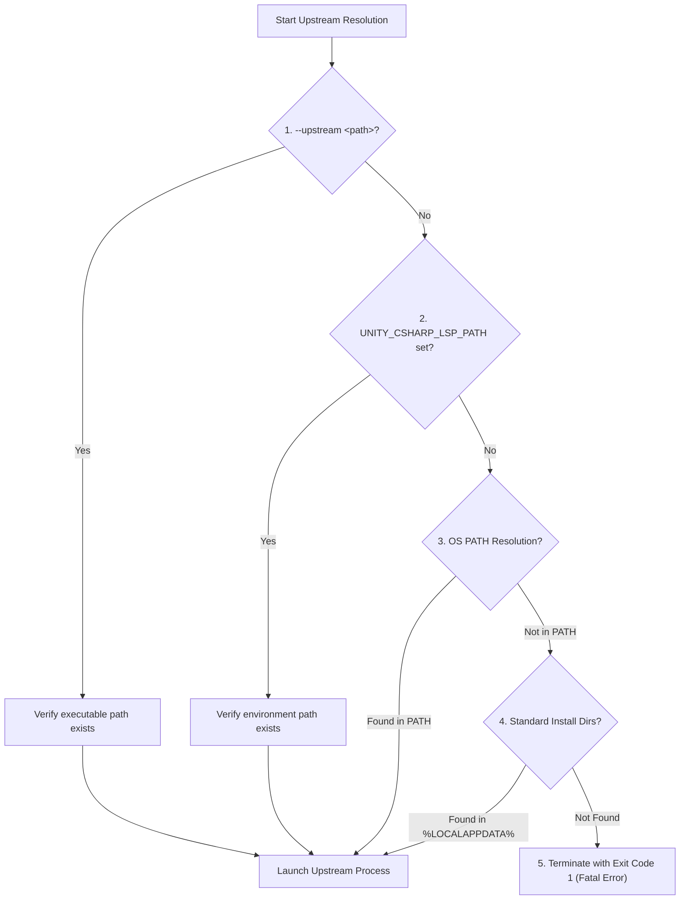

# Intelligent Hybrid Proxy Specification

UnityCSharpFastLSP provides an **Intelligent Hybrid Proxy mode** (`--proxy`) designed to deliver the best of both worlds:
1. **Sub-millisecond responsiveness (< 0.3 ms)** for frequent interactive editor requests (completion, hover, symbols, references, semantic tokens).
2. **Full Roslyn semantic compilation & refactoring power** for heavy workspace operations (definition jumps across external assemblies, rename, code actions, deep type analysis).
3. **Zero initialize latency**: FastLSP responds to client `initialize` immediately (< 0.2 ms), while warming up upstream Roslyn in a non-blocking background queue.

---

## 1. Request Routing Specification Table

The following table details how every LSP method is handled in **Proxy Mode** (`--proxy`) compared to **Standalone Mode**:

| LSP Method | Proxy Mode Handling | Handled By | Advertised in Proxy `initialize` | Latency / Behavior |
| :--- | :--- | :---: | :---: | :--- |
| `initialize` | FastLSP responds immediately to client; forwards to upstream in background | **FastLSP** (Client response) + Upstream (Warmup) | N/A | **< 0.2 ms** (Non-blocking background spawn) |
| `initialized` | Handled by FastLSP & forwarded to upstream | **Both** | N/A | Immediate |
| `shutdown` | Handled by FastLSP & forwarded to upstream | **Both** | N/A | Clean shutdown |
| `exit` | Handled by FastLSP & forwarded to upstream | **Both** | N/A | Process termination |
| `textDocument/didOpen` | Ingested by FastLSP & forwarded to upstream | **Both** | `textDocumentSync: 2` (Incremental) | < 0.5 ms (Fast CST parse + upstream sync) |
| `textDocument/didChange` | Incremental parse in FastLSP & forwarded to upstream | **Both** | `textDocumentSync: 2` (Incremental) | < 30 µs local edits |
| `textDocument/didClose` | Cleaned up in FastLSP & forwarded to upstream | **Both** | N/A | Immediate |
| `textDocument/publishDiagnostics` | Fast syntax diagnostics (CSFF) + Upstream compiler diagnostics (CS) streamed to client | **Both** | N/A | Fast syntax (< 2 ms) + Async Roslyn compiler |
| `textDocument/completion` | Fast CST & SymbolIndex & Unity dictionary | **FastLSP** | `completionProvider: { triggerCharacters: [".", " "] }` | **0.1 ms 〜 0.3 ms** |
| `textDocument/hover` | Fast symbol signature & Unity documentation | **FastLSP** | `hoverProvider: true` | **0.1 ms 〜 0.3 ms** |
| `textDocument/definition` | Fast scoped resolver (local, parameter, class, member, static) | **FastLSP** | `definitionProvider: true` | **0.1 ms 〜 0.3 ms** |
| `textDocument/declaration` | Fast CST & SymbolIndex declaration search | **FastLSP** | `declarationProvider: true` | **0.1 ms 〜 0.4 ms** |
| `textDocument/implementation` | Fast interface/base implementation search | **FastLSP** | `implementationProvider: true` | **0.1 ms 〜 0.4 ms** |
| `textDocument/typeDefinition` | Fast variable type definition resolution | **FastLSP** | `typeDefinitionProvider: true` | **0.1 ms 〜 0.4 ms** |
| `textDocument/references` | Fast workspace symbol reference search | **FastLSP** | `referencesProvider: true` | **0.1 ms 〜 0.5 ms** |
| `textDocument/signatureHelp` | Real-time parameter signatures (`(`, `,`) | **FastLSP** | `signatureHelpProvider: { triggerCharacters: ["(", ","] }` | **0.1 ms 〜 0.2 ms** |
| `textDocument/semanticTokens/full` | Fast CST token highlight encoding | **FastLSP** | `semanticTokensProvider: { legend, full: true }` | **0.2 ms 〜 0.5 ms** |
| `textDocument/documentHighlight` | Fast in-document identifier highlighting | **FastLSP** | `documentHighlightProvider: true` | **0.1 ms 〜 0.2 ms** |
| `textDocument/documentSymbol` | Hierarchical CST symbol tree | **FastLSP** | `documentSymbolProvider: true` | **0.1 ms 〜 0.3 ms** |
| `textDocument/formatting` | Fast bracket & whitespace normalization | **FastLSP** | `documentFormattingProvider: true` | **0.1 ms 〜 0.4 ms** |
| `workspace/symbol` | Sub-millisecond fuzzy/wildcard/CamelCase search | **FastLSP** | `workspaceSymbolProvider: true` | **0.1 ms 〜 0.3 ms** |
| `textDocument/rename` | Forwarded to Upstream Roslyn | **Upstream (Roslyn)** | `renameProvider: true` | Heavy semantic refactoring |
| `textDocument/codeAction` | Forwarded to Upstream Roslyn | **Upstream (Roslyn)** | `codeActionProvider: true` | Roslyn analyzers & quick fixes |

> [!NOTE]
> **Sub-Millisecond `textDocument/definition` in Proxy Mode**:
> FastLSP provides instant definition jumps (< 0.2 ms) across local variables, parameters, self-class fields/methods, base-class inherited members, cross-file dot-member access, and static members directly from memory without blocking on upstream Roslyn. FastLSP advertises `definitionProvider: true` in both standalone and proxy modes.

---

## 2. Upstream Server Discovery Priority

When `--proxy` is enabled, FastLSP locates the upstream Roslyn LSP server (e.g. `UnityCSharpLSP.Server.exe` or `UnityCSharpLSP.exe`) strictly using the following 5-tier priority:

1. **Priority 1 (`--upstream <path>`)**: Explicit command-line argument.
2. **Priority 2 (`UNITY_CSHARP_LSP_PATH`)**: Environment variable pointing to upstream server binary.
3. **Priority 3 (OS API Resolution via `PATH`)**: Direct invocation delegating path lookup to the OS (`CreateProcessW`).
4. **Priority 4 (Standard Directory Fallback)**: Checks `%LOCALAPPDATA%\Programs\UnityCSharpLSP`, `%PROGRAMFILES%\UnityCSharpLSP`, and typical dotnet tool locations.
5. **Priority 5 (Error)**: If all four search stages fail, FastLSP writes an actionable error message to `stderr` and exits immediately with code `1`.

---

## 3. Asynchronous Warmup & Pending Queue Architecture

To eliminate the 800 ms 〜 1500 ms cold startup delay of Roslyn from the user's editing experience:

1. **Background Launch**: FastLSP spawns the upstream process on a worker thread (`InitUpstreamBackground`).
2. **Immediate Capability Reply**: The client receives FastLSP's `ServerCapabilities` within **< 0.2 ms**.
3. **Pending Message Buffer**: Any early messages sent by the client while Roslyn is still booting (`initialize`, `initialized`, `textDocument/didOpen`) are enqueued in a thread-safe `ConcurrentQueue<byte[]> _pendingMessages`.
4. **Automatic Flush**: The instant upstream stdio streams are ready, all buffered messages are flushed in FIFO order, ensuring zero lost states or race conditions.
