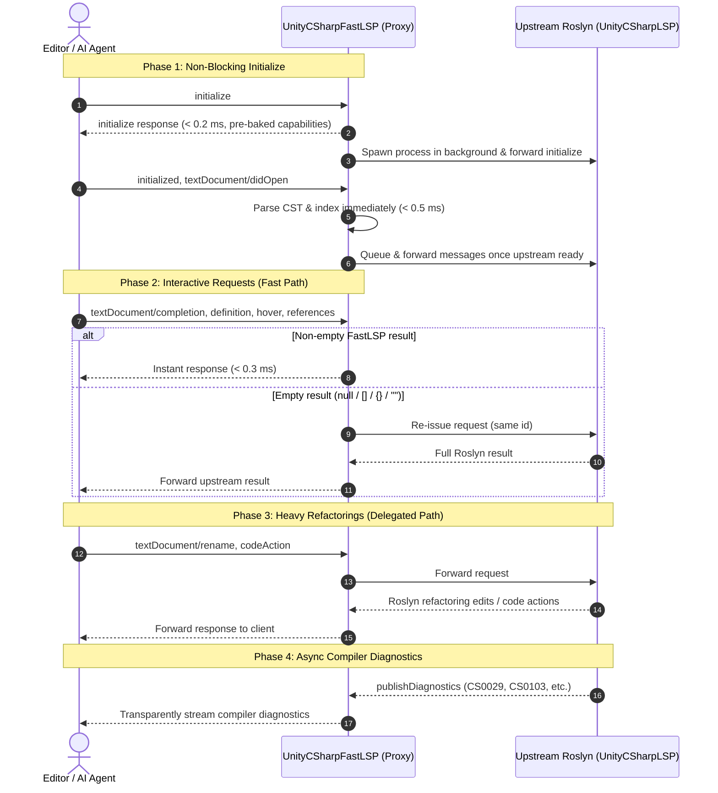
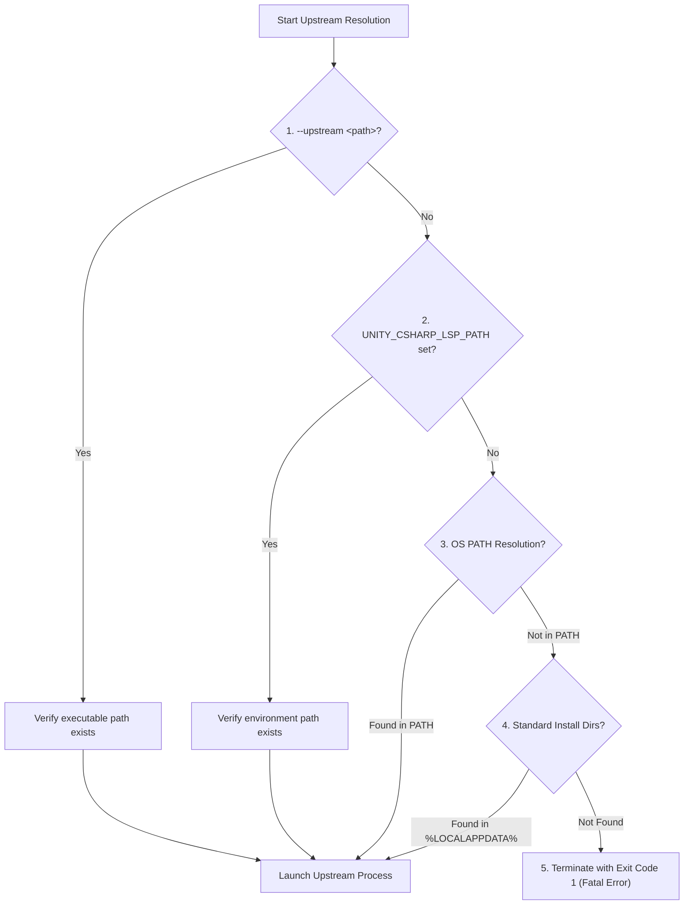

# Intelligent Hybrid Proxy Specification

**Applies to**: `UnityCSharpFastLSP` v0.3.1+  
**Executable**: `UnityCSharpFastLSP.Server.exe --proxy [options]`

UnityCSharpFastLSP provides an **Intelligent Hybrid Proxy mode** (`--proxy`) designed to deliver the ultimate C# editing experience for Unity developers:
1. **Sub-millisecond responsiveness (< 0.3 ms)** for all frequent interactive editor requests (completion, definition, hover, symbols, references, semantic tokens).
2. **Full Roslyn semantic compilation & refactoring power** for heavy workspace operations (rename refactoring, code actions / quick-fixes, deep type analysis).
3. **Zero initialize latency**: FastLSP responds to client `initialize` immediately (< 0.2 ms), while launching and warming up upstream Roslyn in a non-blocking background task.

---

## 1. Request Routing Specification Table

The following table details how every LSP method is handled in **Proxy Mode** (`--proxy`) compared to **Standalone Mode**:

| LSP Method | Proxy Mode Handling | Handled By | Advertised in `initialize` | Latency / Behavior |
| :--- | :--- | :---: | :---: | :--- |
| `initialize` | FastLSP responds immediately (< 0.2 ms); launches upstream in background | **FastLSP** (Client reply) + **Upstream** (Warmup) | N/A | **< 0.2 ms** (Non-blocking background spawn) |
| `initialized` | Handled by FastLSP & forwarded to upstream | **Both** | N/A | Immediate |
| `shutdown` | Handled by FastLSP & forwarded to upstream | **Both** | N/A | Clean shutdown |
| `exit` | Handled by FastLSP & forwarded to upstream | **Both** | N/A | Process termination |
| `textDocument/didOpen` | Ingested by FastLSP & forwarded to upstream | **Both** | `textDocumentSync: 2` (Incremental) | < 0.5 ms (Fast CST parse + upstream sync) |
| `textDocument/didChange` | Incremental parse in FastLSP & forwarded to upstream | **Both** | `textDocumentSync: 2` (Incremental) | < 30 µs local edits |
| `textDocument/didClose` | Cleaned up in FastLSP & forwarded to upstream | **Both** | N/A | Immediate |
| `textDocument/publishDiagnostics` | Fast syntax diagnostics (CSFF) + Upstream compiler diagnostics (CS) streamed to client | **Both** | N/A | Fast syntax (< 2 ms) + Async Roslyn compiler |
| `textDocument/completion` | Fast CST & SymbolIndex & Unity dictionary | **FastLSP** | `completionProvider: { triggerCharacters: [".", " "] }` | **0.1 ms 〜 0.3 ms** |
| `textDocument/hover` | Fast symbol signature & Unity documentation | **FastLSP** | `hoverProvider: true` | **0.1 ms 〜 0.3 ms** |
| `textDocument/definition` | Fast scoped resolver (local, parameter, class, member, static) | **FastLSP** | `definitionProvider: true` | **0.1 ms 〜 0.3 ms** |
| `textDocument/declaration` | Fast CST & SymbolIndex declaration search | **FastLSP** | `declarationProvider: true` | **0.1 ms 〜 0.4 ms** |
| `textDocument/implementation` | Fast interface/base implementation search | **FastLSP** | `implementationProvider: true` | **0.1 ms 〜 0.4 ms** |
| `textDocument/typeDefinition` | Fast variable type definition resolution | **FastLSP** | `typeDefinitionProvider: true` | **0.1 ms 〜 0.4 ms** |
| `textDocument/references` | Fast workspace symbol reference search | **FastLSP** | `referencesProvider: true` | **0.1 ms 〜 0.5 ms** |
| `textDocument/signatureHelp` | Real-time parameter signatures (`(`, `,`) | **FastLSP** | `signatureHelpProvider: { triggerCharacters: ["(", ","] }` | **0.1 ms 〜 0.2 ms** |
| `textDocument/semanticTokens/full` | Fast CST token highlight encoding | **FastLSP** | `semanticTokensProvider: { legend, full: true }` | **0.2 ms 〜 0.5 ms** |
| `textDocument/documentHighlight` | Fast in-document identifier highlighting | **FastLSP** | `documentHighlightProvider: true` | **0.1 ms 〜 0.2 ms** |
| `textDocument/documentSymbol` | Hierarchical CST symbol tree | **FastLSP** | `documentSymbolProvider: true` | **0.1 ms 〜 0.3 ms** |
| `textDocument/formatting` | Fast bracket & whitespace normalization | **FastLSP** | `documentFormattingProvider: true` | **0.1 ms 〜 0.4 ms** |
| `workspace/symbol` | Sub-millisecond fuzzy/wildcard/CamelCase search | **FastLSP** | `workspaceSymbolProvider: true` | **0.1 ms 〜 0.3 ms** |
| `textDocument/rename` | Forwarded to Upstream Roslyn | **Upstream (Roslyn)** | `renameProvider: true` | Heavy semantic refactoring |
| `textDocument/codeAction` | Forwarded to Upstream Roslyn | **Upstream (Roslyn)** | `codeActionProvider: true` | Roslyn analyzers & quick fixes |

### 1.1 Empty-Result Fallback (v0.3.1+)

FastLSP answers the fast-path methods above, but when its result is empty (`null`, `[]`, `{}`, or `""`), the proxy treats it as "not resolved locally" and transparently re-issues the same request (same JSON-RPC `id`) to the upstream Roslyn server. The empty FastLSP response is discarded, and the upstream response is forwarded to the client.

- Applies only in `--proxy` mode, and only while the upstream is started and alive.
- Non-empty FastLSP responses are never forwarded, so the sub-millisecond fast path is unchanged.
- Error responses are not retried; only empty successful results trigger the fallback.
- In `--mcp --proxy` mode the same behavior applies through `LspProxy`, and the MCP tool call waits for the upstream response.

---

## 2. Architecture & Request Flow

The following diagram illustrates the interaction between the Client (Editor / AI Agent), FastLSP proxy frontend, and the Upstream Roslyn LSP server:

---

## 3. High-Precision `textDocument/definition` Resolver

In v0.2.1, `textDocument/definition` is fully integrated into FastLSP's fast path and verified across real-world Unity project code (`DummyProject`):

1. **Local Variables & Parameters**:
   - Scope-restricted token search inside method / lambda body.
   - Accurately resolves local variable declarations (`int localDmg = 15;`) and method parameters (`ApplyDamage(int amount)`).
   - Prevents self-loop when cursor is already on the declaration token.
2. **Self-Class Fields & Methods**:
   - Matches members via `SymbolIndex.FindMembersByContainingType(selfClassName)`.
   - Distinguishes private/public fields (`private GameConfig config;`) and methods (`private void Report(int amount)`).
3. **Inheritance & Base Class Members**:
   - Traverses type hierarchy via `SymbolIndex.GetAllBaseTypes(selfClassName)`.
   - Resolves inherited members (e.g. `Player` calling base `Entity.Heal()`).
4. **Cross-File Member Access**:
   - Infers variable type (`var enemy = new Enemy()` -> `Enemy`, `private GameConfig config` -> `GameConfig`).
   - Resolves dot-access (`config.MaxHealth`) directly to the target declaration in external files.
5. **Static Calls & Class Declarations**:
   - Resolves static methods (`Calculator.Add`) and type names (`new Player()`, `: IDamageable`).

---

## 4. Upstream Server Discovery Priority

When `--proxy` is enabled, FastLSP locates the upstream Roslyn LSP server (e.g. `UnityCSharpLSP.Server.exe` or `UnityCSharpLSP.exe`) strictly using the following 5-tier priority:

| Tier | Search Strategy | Detail |
| :---: | :--- | :--- |
| **1** | **Explicit `--upstream <path>`** | Command line argument specifying the exact executable path. |
| **2** | **`UNITY_CSHARP_LSP_PATH` Env Var** | Environment variable pointing to upstream binary. |
| **3** | **OS API Resolution via `PATH`** | Direct invocation delegating path lookup to the OS (`CreateProcessW`). |
| **4** | **Standard Directory Fallback** | Checks `%LOCALAPPDATA%\Programs\UnityCSharpLSP`, `%PROGRAMFILES%\UnityCSharpLSP`, and dotnet tools. |
| **5** | **Fatal Error Termination** | If all 4 search tiers fail, outputs an actionable error message to `stderr` and terminates with exit code `1`. |

---

## 5. Non-Blocking Startup & Pending Queue Architecture

To completely eliminate the 800 ms 〜 1500 ms cold startup delay of Roslyn from the user experience:

1. **Background Launch**: FastLSP spawns the upstream process on a worker thread (`InitUpstreamBackground`).
2. **Immediate Capability Reply**: The client receives FastLSP's `ServerCapabilities` within **< 0.2 ms**.
3. **Pending Message Buffer**: Any early messages sent by the client while Roslyn is booting (`initialize`, `initialized`, `textDocument/didOpen`) are enqueued in a thread-safe `ConcurrentQueue<byte[]> _pendingMessages`.
4. **Automatic Flush**: The instant upstream stdio streams are ready, all buffered messages are flushed in FIFO order, ensuring zero dropped messages or desynchronizations.

---

## 6. MCP モードからのプロキシ利用

MCP サーバーとして起動する場合（`UnityCSharpFastLSP.Server.exe --mcp --proxy [--upstream <path>]`）も、同じ `LspProxy` を経由します。

- MCP ツールのうち、§1 の FastLSP 応答メソッド（completion・hover・definition・references など）は FastLSP が即答します。
- FastLSP の結果が空（`null` / `[]` / `{}` / `""`）の場合、§1.1 のとおり同じリクエストを UnityCSharpLSP に再委譲し、その応答を MCP ツール結果として返します。
- それ以外（rename・codeAction・型階層・コンパイラ診断・`unitycsharp.*` コマンドなど）は UnityCSharpLSP に委譲されます。
- ルーティングは `LspProxy.FastMethods` の判定に一任しており、MCP 層では独自判定しません。
- `--mcp` のみ（`--proxy` なし）の場合は、委譲せず LSP エラー `-32601` を返します。

詳細は [doc/mcp.md](mcp.md) を参照してください。
